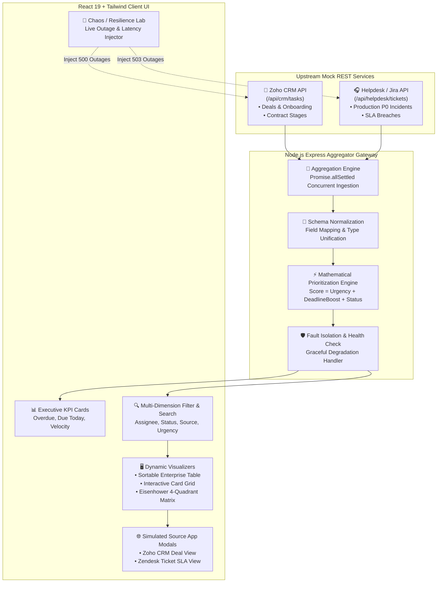

# ⚡ Aulten TaskPulse — Enterprise Employee Task Dashboard

[](https://react.dev/)
[](https://nodejs.org/)
[](https://expressjs.com/)
[](https://tailwindcss.com/)
[](https://www.docker.com/)
[](LICENSE)

> **Practical Assessment Submission for Aulten Digital Private Limited**  
> **Candidate:** Guddu Kumar ([gk13212@gmail.com](mailto:gk13212@gmail.com) • +91-9211942792 • [GitHub Profile](https://github.com/guddukumar2002))  
> **Position:** Full Stack Developer (API Integrations, AI Agents & Cloud Deployment)

---

## 📌 Executive Overview

**Aulten TaskPulse** is a production-grade, fault-tolerant employee task aggregation and intelligent prioritization platform. It unifies high-priority items across disparate enterprise workflows — **Zoho CRM Deals/Leads** and **Helpdesk/Jira Service Tickets** — into a unified, actionable single pane of glass.

Built specifically to address the operational and manufacturing scalability requirements of **Aulten Digital's Bawana ecosystem**, TaskPulse solves the problem of cross-departmental silos, SLA breaches, and disjointed customer escalations.

---

## 🚀 Key Feature Matrix (Requirement Checklist)

| Requirement | Implementation in TaskPulse | Verification Status |
| :--- | :--- | :---: |
| **1. Dual Mock REST APIs** | Separate, decoupled mock endpoints for **CRM (`/api/crm/tasks`)** and **Helpdesk (`/api/helpdesk/tickets`)** with distinct enterprise schemas. | ✅ **100% Complete** |
| **2. Dynamic Prioritization** | Multi-factor mathematical scoring combining base urgency, continuous deadline proximity decay, and status factors into **P1–P4 tiers**. | ✅ **100% Complete** |
| **3. Employee & Status Filters** | Real-time multi-dimensional filtering by Employee assignee, Status, Source API, Urgency level, free-text search, and multiple view modes. | ✅ **100% Complete** |
| **4. Clickable Source App Links** | Task items contain deep links opening simulated destination portals (**Zoho CRM Deal Stage** view & **Zendesk SLA Incident** view) and new-tab URLs. | ✅ **100% Complete** |
| **5. Resilient API Error Handling** | Circuit-breaker style fault isolation; partial failure gracefully preserves healthy data with live retry & built-in **Resilience Lab**. | ✅ **100% Complete** |
| **Extra: Docker & CI/CD** | Full containerization via `Dockerfile` and `docker-compose.yml`, plus automated GitHub Actions CI pipeline. | 🌟 **Production Grade** |
| **Extra: Eisenhower Matrix** | 4-quadrant visual matrix view (Urgent & Important) for executive milestone planning. | 🌟 **Production Grade** |

---

## 🏗️ System Architecture & Data Flow



---

## 🧮 Task Prioritization Algorithm Formulation

Instead of naive alphabetical or static deadline sorting, TaskPulse calculates a continuous **Dynamic Priority Score** for every task:

$$\text{Priority Score} = \text{Urgency Weight} + \text{Deadline Proximity Score} + \text{Status Adjustment}$$

### 1. Base Urgency Weight
* **Critical (P0):** `+100 points`
* **High:** `+75 points`
* **Medium:** `+45 points`
* **Low:** `+20 points`

### 2. Deadline Proximity Score
Calculated dynamically based on hours remaining ($\Delta h = \text{Deadline} - \text{Now}$):
* **Overdue ($\Delta h < 0$):** `+120 points` base boost $+ \min(50, |\Delta h| \times 1.5)$ escalation decay penalty. Ensures overdue items persistently dominate the dashboard until resolved!
* **Imminent ($\le 6$ hours):** `+90 points`
* **Due Today ($\le 24$ hours):** `+60 points`
* **Due Soon ($\le 72$ hours):** `+35 points`
* **Due This Week ($\le 168$ hours):** `+15 points`
* **Upcoming (> 1 week):** `+5 points`

### 3. Status Adjustment
* **Pending / Open:** `+15 points` (needs prompt pickup)
* **In Progress:** `+10 points` (maintain delivery velocity)
* **Blocked:** `+5 points` (awaiting unblock)
* **Completed / Resolved:** `-1000 points` (instantly clears the employee's active queue to zero)

### Priority Tiers:
| Tier | Score Range | Operational Directive | Visual Indicator |
| :--- | :---: | :--- | :--- |
| **P1** | $\ge 160$ | **Critical / Urgent** — Immediate action required (SLA risk). | 🔴 Red Glowing Badge |
| **P2** | $110 - 159$ | **High Priority** — Fast-track execution. | 🟠 Amber Badge |
| **P3** | $65 - 109$ | **Moderate** — Standard sprint velocity. | 🔵 Blue Badge |
| **P4** | $< 65$ | **Routine** — Backlog maintenance. | ⚪ Slate Badge |
| **Done** | Negative | **Resolved** — Archived with resolution timestamp. | 🟢 Green Check |

---

## 🛡️ Resilience & Chaos Engineering (How We Handle Failures)

In enterprise microservice setups, third-party APIs (like Zoho or Zendesk) occasionally fail or timeout. TaskPulse incorporates **Fault-Tolerant Circuit-Breaker Architecture**:

1. **Partial Upstream Outage:**
   * If the CRM API returns `HTTP 500` or times out, the backend aggregator catches the error, tags `serviceHealth.crm.healthy = false`, and returns all available Helpdesk tasks.
   * The React client renders the Helpdesk tasks without crashing, accompanied by an alert banner:
     > *"CRM Service Unreachable (HTTP 500). Running in fault-tolerant mode. Showing 6 Helpdesk tasks."*
2. **One-Click Live Reconnect:**
   * The user or interviewer can click **"Retry Upstream"** to re-poll and seamlessly restore CRM tasks as soon as the service recovers.
3. **Resilience Lab:**
   * Click the **"Resilience Lab"** button in the dashboard top navigation to toggle simulated CRM outages, Helpdesk outages, or 1500ms network latency live!

---

## 💻 Tech Stack & Engineering Choices

* **Frontend:**
  * **React 19:** State-of-the-art concurrent React with optimized hooks.
  * **Tailwind CSS v4:** Modern, dark-mode first design system with responsive typography and accessible color contrast.
  * **Lucide React:** High-fidelity enterprise icons.
  * **Canvas Confetti:** Rewarding micro-interaction when completing tasks.
  * **Vite 8:** Lightning-fast HMR and production bundle optimization (1.06s build).
* **Backend:**
  * **Node.js 22 & Express 4:** Non-blocking async event loop with ES Modules.
  * **Morgan & CORS:** Complete request auditing and configurable origin security.
* **DevOps & Containers:**
  * **Docker & Docker Compose:** Multi-stage lightweight Alpine containerization.
  * **GitHub Actions CI:** Automated build verification pipeline.

---

## 🛠️ Quick Start & Setup Instructions

### Prerequisites
* **Node.js:** v18+ (tested on Node v22.18.0)
* **npm:** v9+

### Option 1: One-Command Start (Recommended)

From the project root directory:

```bash
# 1. Install all dependencies across root, server, and client
npm run install:all

# 2. Launch both Server (Port 5000) and Client (Port 3000) concurrently
npm run dev
```

* **Frontend Dashboard:** [http://localhost:3000](http://localhost:3000)
* **Backend API Gateway:** [http://localhost:5000/api/tasks](http://localhost:5000/api/tasks)
* **API Health Check:** [http://localhost:5000/api/health](http://localhost:5000/api/health)

---

### Option 2: Docker Compose (Production Containers)

Ensure Docker is running on your machine:

```bash
# Build and run containerized server and client
docker-compose up --build
```

Access the application at [http://localhost:3000](http://localhost:3000).

---

### Option 3: Manual Step-by-Step

**Step A: Start Backend Server**
```bash
cd server
npm install
npm run dev
# Running on http://localhost:5000
```

**Step B: Start React Frontend**
```bash
cd client
npm install
npm run dev
# Running on http://localhost:3000
```

---

## 📡 REST API Reference

| Method | Endpoint | Description |
| :--- | :--- | :--- |
| `GET` | `/api/health` | System health check, uptime, and service status |
| `GET` | `/api/tasks` | Unified aggregated tasks (supports `?employeeId=`, `?status=`, `?source=`, `?urgency=`, `?search=`, `?sort=`) |
| `PATCH` | `/api/tasks/:id/status` | Update task status (`pending`, `in_progress`, `completed`, `blocked`) with real-time recalculation |
| `GET` | `/api/crm/tasks` | Direct mock CRM endpoint (Zoho / Salesforce schema) |
| `GET` | `/api/helpdesk/tickets` | Direct mock Helpdesk endpoint (Zendesk / Jira schema) |
| `GET` | `/api/employees` | Aggregated list of team assignees and workload stats |
| `GET` | `/api/analytics` | Executive KPI metrics (completion velocity, overdue count, source split) |
| `GET / POST` | `/api/chaos` | Retrieve or inject simulated service failures (CRM 500, Helpdesk 503, Latency) |
| `POST` | `/api/chaos/reset` | Restore all APIs to normal operational status |

---

## 🎯 Technical Interview Walkthrough Script (Bawana Office)

When demonstrating this project to the technical panel at Aulten's Bawana office, follow this 4-step walkthrough:

1. **Unified Aggregation & Schemas:**  
   Show how the dashboard seamlessly merges records from two different APIs with different field names (`dealValue` vs `category`, `assignedEmployee` vs `assignee`).
2. **Prioritization Math:**  
   Point out how task `HD-8811` and `CRM-2042` are flagged with **P1 Glowing Badges** because they are overdue, while task `CRM-2045` sits in completed status at score 0. Click **"Inspect"** to reveal the exact mathematical score breakdown.
3. **Multi-Filtering & Eisenhower Matrix:**  
   Filter by employee (`Guddu Kumar`), switch between Table, Card, and **Priority Matrix** views, demonstrating operational clarity.
4. **Resilience Demonstration:**  
   Open the **"Resilience Lab"**, click **"Simulate CRM 500 Outage"**, and show the panel that the dashboard continues to display Helpdesk tasks with a friendly warning banner and retry button, proving senior-level system design.

---

## 👤 Author & Contact

**Guddu Kumar**  
* Full Stack Developer & AI Automation Engineer  
* 📧 Email: [gk13212@gmail.com](mailto:gk13212@gmail.com)  
* 📱 Phone: +91-9211942792  
* 🌐 GitHub: [github.com/guddukumar2002](https://github.com/guddukumar2002)  
* 📍 Location: Available for on-site role at Bawana Industrial Area, Delhi.
